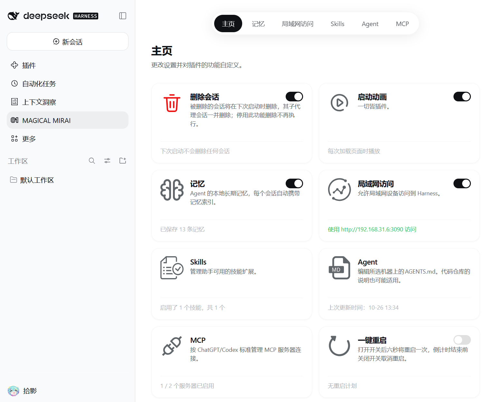

# dsh-mikufan

DeepSeek Harness 的插件包（bundle）。版本 **1.1.4**，MIT 许可。

魔法未来为 DSH 增加/强化了八个功能：删除会话、启动动画、记忆、局域网访问、Skills 管理、Agent 自定义、MCP 管理和一键重启。全部收在侧栏「MAGICAL MIRAI」控制面板里。

## 功能

| 功能 | 简介 |
| --- | --- |
| **删除会话** | 标记后**下次启动**时删除。 |
| **启动动画** | 页面加载时播放光点汇聚动画。 |
| **记忆** | 本地长期记忆：`memory_*` 四个工具，标题索引注入、按工作区隔离，面板可导出/导入。 |
| **局域网访问** | 默认 3090 端口的反向代理。 |
| **Skills** | 管理 `~/.dsh/skills`，自带 `skill-creator`。 |
| **Agent** | 编辑用户全局 `~/.dsh/AGENTS.md`。 |
| **MCP** | 按 ChatGPT / Codex 的 `mcp_servers` 标准管理服务器。 |
| **一键重启** | 打开开关后 6 秒倒计时重启 DSH。 |

## MAGICAL MIRAI 控制面板

## 更新日志

| 版本 | 主要内容 |
| --- | --- |
| **1.1.4** | 改进了记忆模块。 |
| 1.1.3 | 解决了一些已知问题。 |
| 1.1.2 | 解决了一些已知问题。 |
| 1.1.1 | 优化了启动（重启）动画。 |
| 1.1.0 | 终端输出简化；启动性能优化。 |
| 1.0.6 | 新增「一键重启」。 |
| 1.0.0 | 首个公开版本：删除会话、启动动画、记忆、局域网访问、Skills、Agent、MCP。 |

## 许可证

[MIT](LICENSE)
