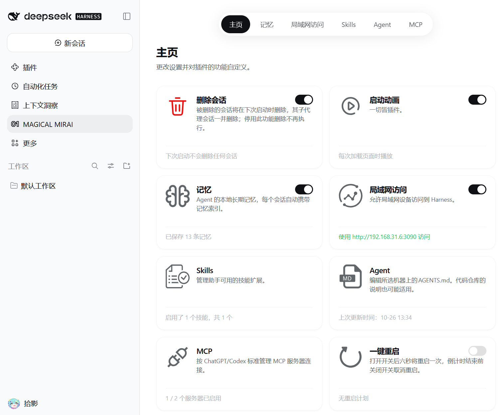

# dsh-mikufan

DeepSeek Harness 的插件包（bundle）。版本 **1.1.0**，MIT 许可。

魔法未来为 DSH 增加/强化了八个功能：删除会话、启动动画、记忆、局域网访问、Skills 管理、Agent 自定义、MCP 管理和一键重启。全部收在侧栏「MAGICAL MIRAI」控制面板里。

## 功能

| 功能 | 简介 |
| --- | --- |
| **删除会话** | 标记后**下次启动**时删除（含子代理会话）；标记期间再发消息会自动还原。 |
| **启动动画** | 页面加载时播放光点汇聚动画；任意键或点击立即跳过，系统开启「减少动态效果」时只保留结束帧。 |
| **记忆** | 本地长期记忆：`memory_*` 四个工具，外加每次组装提示词时注入的索引。 |
| **局域网访问** | 默认 3090 端口的反向代理，按 IP 限制连接数；每次启动默认关闭，需在面板手动开启。 |
| **Skills** | 管理 `~/.dsh/skills`，自带 `skill-creator`；可开关、新建、查看详情、卸载。 |
| **Agent** | 编辑用户全局 `~/.dsh/AGENTS.md`；代码仓库自带的项目级说明仍由 DSH 自己合并。 |
| **MCP** | 按 ChatGPT / Codex 的 `mcp_servers` 标准管理服务器；开关会联动运行中的组合，无需重启。 |
| **一键重启** | 打开开关后 6 秒倒计时重启 DSH；倒计时内关掉即取消；有会话在跑时不可用。 |

## MAGICAL MIRAI 控制面板

## 更新日志

| 版本 | 主要内容 |
| --- | --- |
| **1.1.0** | 终端输出简化：启动只留 1 行、面板操作静默、清扫只报一行汇总；启动性能优化：没有待删会话时不再扫描会话、不再重写状态文件，清扫延后 1.5 秒，局域网地址检测加缓存；README 与元数据刷新。 |
| 1.0.6 | 新增「一键重启」；记忆 / Skills / MCP 卡片按更新时间从新到旧；仪表页卡片可点进子页。 |
| 1.0.0 | 首个公开版本：删除会话、启动动画、记忆、局域网访问、Skills、Agent、MCP。 |

## 许可证

[MIT](LICENSE)
